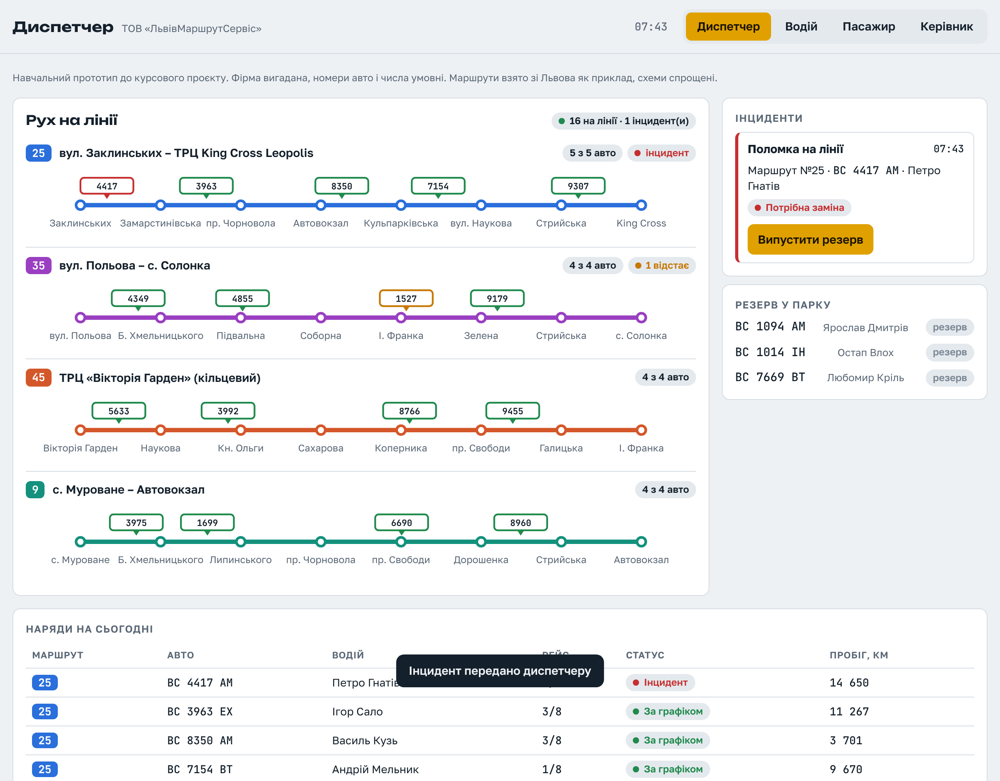

# АІС «Диспетчер» – клікабельний прототип

Прототип інтерфейсу до курсової роботи з дисципліни «Технології управління ІТ-проєктами» (НУ «Львівська політехніка», кафедра ІСМ).

**Тема:** «Проектування систем для фірм, що здійснюють автотранспортне перевезення на мікроавтобусах „Пежо“ в межах міста Львова».

**Виконала:** Ювженко Оксана, група ІТУП-11з. **Керівник:** доц. каф. ІСМ Кісь Я. П.

## Що показує прототип

Система має чотири ролі. Їх перемикають кнопки вгорі сторінки.

| Роль | Що бачить |
|---|---|
| Диспетчер | Схеми маршрутів № 9, 25, 35, 45 з авто на лінії, інциденти, резерв, наряди на день |
| Водій | Наряд, результати медогляду і техогляду, поточний рейс, кнопку «Повідомити про поломку» |
| Пасажир | Час прибуття авто на обрану зупинку, попередження про зміни в русі, форму скарги |
| Керівник | Регулярність руху (поріг 90 %), випуск на лінію, виручку за способами оплати, черговість ТО |

Ролі пов'язані між собою. Сценарій для перегляду:

1. Відкрийте роль «Водій» і натисніть «Повідомити про поломку».
2. Перейдіть до ролі «Диспетчер». В інцидентах з'явилася поломка. Натисніть «Випустити резерв».
3. Відкрийте роль «Пасажир», маршрут № 25. Зверху з'явилося попередження про затримку.
4. У ролі «Керівник» видно, як інцидент вплинув на показники.

## Технічно

Одна HTML-сторінка без збірки і без сервера. Дані умовні й генеруються в браузері. Рух авто імітується щосекунди.

Фірма ТОВ «ЛьвівМаршрутСервіс» вигадана. Номери авто, імена водіїв і всі числа умовні. Маршрути взято зі Львова як приклад, схеми спрощені.
